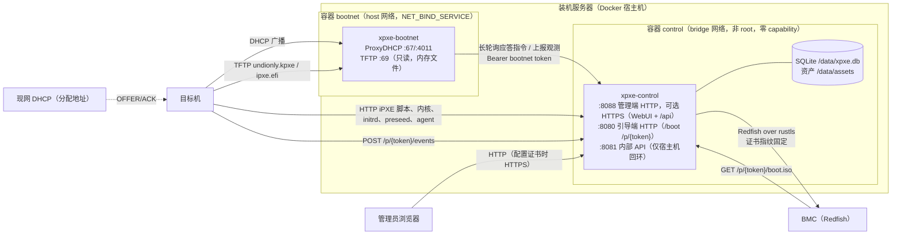
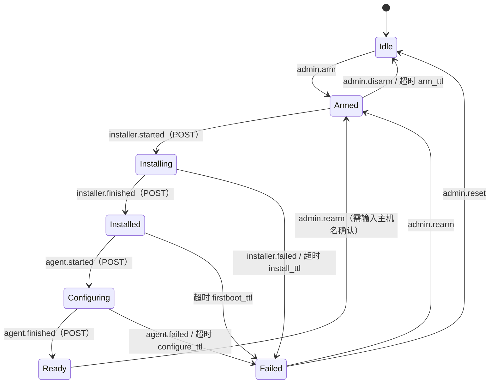

# x-pxe：Debian 13 自动装机平台实施方案

x-pxe 用一套 Rust 程序和一个 Web 控制台，把裸机或虚拟机从“上电”带到“Debian 13（trixie）装好并完成初始化”，全程不依赖宿主机上的 dnsmasq、xorriso、mtools、grub、curl、openssl 等系统组件。

本目录是完整的实施方案：本文件给出全局设计，`step-NN-*.md` 按顺序落地，每一步都能单独验收。

配套规范（约束性文件，方案内只引用、不复述）：

| 文件 | 作用 |
| :--- | :--- |
| [`../rust-lint-gate.md`](../rust-lint-gate.md) | Rust 最严 Lint 门禁。所有 Rust 步骤的完成条件都包含 `scripts/gate.sh` 全绿 |
| [`../webui-style-guide.md`](../webui-style-guide.md) | WebUI 风格与交互规范（Park UI 系统提示词原文） |
| [`../webui-ref/exhtml/`](../webui-ref/exhtml/) | WebUI “字典级”参考实现：Token、组件、布局、交互、四态的出处 |
| [`../../legacy/`](../../legacy/) | 现网脚本 `pxe-server.sh`、`init-d13.sh`，是装机参数与初始化模块的需求来源 |

---

## 1. 目标与范围

### 1.1 v1 范围内

| 能力 | 说明 |
| :--- | :--- |
| 局域网 PXE（BIOS） | NIC PXE ROM → TFTP `undionly.kpxe` → iPXE → HTTP |
| 局域网 PXE（UEFI x64） | UEFI PXE → TFTP `ipxe.efi`（或 `snponly.efi`）→ iPXE → HTTP |
| UEFI HTTP Boot（x64） | UEFI HTTP Boot → HTTP `ipxe.efi` → iPXE → HTTP |
| 复用现有 DHCP | 现有 DHCP 服务器指向本系统（next-server/filename），本系统只做 TFTP/HTTP |
| ProxyDHCP | 本系统只回引导信息、不分配地址，与现网 DHCP 并存 |
| Redfish Virtual Media（仅 UEFI） | 每次装机生成一个小 ISO（官方 `ipxe.efi` + 内嵌脚本，只含 UEFI 引导项）。BIOS 节点一律走局域网 PXE |
| Debian 13 无人值守安装 | preseed、静态 IP、确定性选盘、分区方案、APT 源，内核/initrd 与镜像源 ABI 对齐 |
| 初始化模块 | `legacy/init-d13.sh` 的全部功能拆成有类型的模块，Web 上编辑、预览、对比、回滚 |
| 资产管理 | iPXE 与 Debian netboot 在 Web 上下载（或离线上传）、校验、激活、金丝雀、回滚 |
| 防重装 | 仅 `Armed` 节点会得到 DHCP 应答；iPXE 入口对非 `Armed` 节点一律 `exit` |
| 安全 | 管理端登录、会话与 API Token；装机令牌高熵、限时、一次性；主密钥外部注入；审计哈希链 |

### 1.2 v1 明确不做

| 不做 | 原因与替代 |
| :--- | :--- |
| 完整 DHCP 服务器（分配地址） | 租约、冲突检测、多网段中继的风险远高于收益。用现网 DHCP 或 ProxyDHCP |
| 跨三层中继的 ProxyDHCP | ProxyDHCP 依赖同一二层广播。跨网段用“复用现有 DHCP”模式 |
| ARM64、IA32 客户端 | DHCP 层识别 Option 93 = 6/10/11/19 并记录“不支持的架构”，不应答。类型系统为 arm64 预留枚举值 |
| Redfish 引导 BIOS 服务器 | Redfish 引导 ISO 只含 UEFI 项；BIOS 服务器登记时只能选局域网 PXE 通道 |
| UEFI Secure Boot | 目标机需关闭 Secure Boot。资产模型预留 `ipxe-shim` 类型，后续接入 iPXE 官方签名包 |
| 非 Debian 13 系统 | `OsFamily` 只有 `Debian13`。新增系统时扩展渲染器，不改状态机 |

---

## 2. 设计原则

1. **单一事实来源**：节点是否该装机只由控制面数据库里的状态机决定。引导网络进程不读配置文件，只接收控制面推送的“应答指令”。
2. **默认拒绝**：未知 MAC、非 `Armed` 节点、控制面失联、令牌过期，一律不应答或返回 `exit`。
3. **GET 无状态副作用**：任何 GET 都不推进状态机。状态只由 POST 事件（管理员、安装器、目标机 agent、引导网络进程）和服务端定时器推进。
4. **类型优先**：Web 只能编辑有类型、有取值范围的配置，服务端把它渲染成脚本。唯一的自由文本脚本入口是默认关闭、单独审计的“自定义片段”模块。
5. **零系统依赖**：控制面容器 `FROM scratch`，只有静态 musl 二进制和 Web 静态文件。ISO、FAT、哈希、签名、HTTP、TLS、模板全部在 Rust 里完成。
6. **可回滚**：所有 Web 可改的配置都是不可变版本链，带作者、时间、差异，回滚即生成一个新版本。
7. **先验证、后铺开**：引导链路在 Step 2 的隔离虚拟实验室中先跑通并沉淀成测试夹具，WebUI 放在后端闭环之后；真实硬件兼容性作为发布后的可选验收。

---

## 3. 架构



纯文本版：

```text
 管理员 ──HTTP(S):8088─▶ ┌──────────────── xpxe-control（容器 control）────────────────┐
                        │ WebUI 静态文件 │ 管理 API │ 引导端点 :8080 │ 内部 API :8081   │
 BMC ◀──Redfish/rustls── │ 状态机 + 定时器 │ 渲染器 │ 资产仓 │ ISO 构建 │ 审计       │
 BMC ──GET boot.iso────▶ └───────────────▲───────────────────────────▲───────────────┘
                                         │ 长轮询指令/上报观测        │ HTTP 引导与回调
                          ┌──────────────┴───────────┐                │
 目标机 ──DHCP/TFTP──────▶ │ xpxe-bootnet（host 网络） │                │
                          │ ProxyDHCP + 只读 TFTP     │      目标机 ───┘
                          └──────────────────────────┘
 现网 DHCP ──分配地址──▶ 目标机
```

### 3.1 进程、端口与权限

| 进程 | 容器网络 | 端口 | 权限 | 说明 |
| :--- | :--- | :--- | :--- | :--- |
| `xpxe-control` | bridge | 8088/tcp 管理端（HTTP；配置证书时 HTTPS）<br>8080/tcp 引导端（HTTP）<br>8081/tcp 内部 API（只映射到宿主机 `127.0.0.1`） | UID 10001，`cap_drop: [ALL]`，只读根文件系统 | 唯一持有数据库与主密钥的进程 |
| `xpxe-bootnet` | host | 67/udp、4011/udp、69/udp + TFTP 临时端口 | UID 10001，`cap_add: [NET_BIND_SERVICE]`；内核 < 5.7 时额外需要 `NET_RAW`（`SO_BINDTODEVICE`），启动时自检并给出明确报错 | 无数据库、无主密钥、无管理端代码 |
| `xpxe-agent` | 目标机 | 无监听 | root（systemd 一次性服务） | 执行初始化模块并回报，完成后自删 |

两个服务进程来自同一个镜像、同一个 Cargo workspace，是两个独立的二进制。特权进程 `xpxe-bootnet` 里不链接任何管理端、数据库、渲染代码，攻击面只剩 DHCP/TFTP 解析和一条到控制面的 HTTP 连接。

### 3.2 引导链路

| 场景 | 链路 | DHCP 层判定 |
| :--- | :--- | :--- |
| LAN BIOS | ROM DISCOVER（Opt93=0）→ ProxyDHCP 应答 TFTP `undionly.kpxe` → iPXE DISCOVER（Opt77=`iPXE`）→ 应答 `http://<boot>:8080/p/{token}/boot.ipxe` | MAC 必须处于 `Armed` |
| LAN UEFI | ROM DISCOVER（Opt93=7/9）→ 4011 端口 REQUEST → 应答 TFTP `ipxe.efi` → iPXE 二次 DHCP → 同上 | 同上 |
| UEFI HTTP Boot | DISCOVER（Opt60=`HTTPClient:Arch:00016…`）→ 应答 Opt60=`HTTPClient` + `http://<boot>:8080/fw/x64/ipxe.efi` → iPXE 二次 DHCP → 同上 | 同上 |
| 复用现有 DHCP | 现网 DHCP 下发 next-server=本机、filename=`undionly.kpxe`/`ipxe.efi`；iPXE 阶段 filename=`http://<boot>:8080/boot.ipxe` → `chain /boot/mac/${net0/mac:hexhyp}` | bootnet 不发 DHCP，只跑 TFTP；`/boot/mac/{mac}` 对非 `Armed` 返回 `exit` |
| Redfish | 控制面生成 `boot.iso`（官方 iPXE ISO 重新封装，内含 `autoexec.ipxe`）→ InsertMedia → 一次性从 CD 启动 → iPXE 直接 `chain http://<boot>:8080/p/{token}/boot.ipxe` | 不经过 DHCP 引导应答；令牌只在本次装机会话内有效 |

所有 URL 都由静态配置 `XPXE_BOOT_BASE_URL`（例如 `http://192.168.2.3:8080`）拼出，端口始终写全。

### 3.3 节点状态机



| 状态 | 含义 | 默认超时（Web 可调） | 超时去向 |
| :--- | :--- | :--- | :--- |
| `Idle` | 未授权装机 | 无 | - |
| `Armed` | 本次装机会话已创建，允许引导 | `arm_ttl` 2 h | `Idle`（会话作废） |
| `Installing` | d-i 已启动 | `install_ttl` 90 min | `Failed(Timeout)` |
| `Installed` | d-i 完成，等待首次启动 | `firstboot_ttl` 30 min | `Failed(Timeout)` |
| `Configuring` | agent 执行初始化模块 | `configure_ttl` 60 min | `Failed(Timeout)` |
| `Ready` | 完成并锁定，任何网络引导都回本地盘 | 无 | - |
| `Failed` | 失败，保留原因与日志尾部，需人工处理 | 无 | - |

只有 `Armed` 会让 bootnet 应答，也只有 `Armed` 会让 `/boot/mac/{mac}` 返回安装脚本。`Installing` 之后即使目标机再次网络引导，也只会得到 `exit`，不会二次格盘。

---

## 4. 仓库与 Crate 布局

```text
x-pxe/
├── Cargo.toml  Cargo.lock  rust-toolchain.toml  clippy.toml  rustfmt.toml
├── crates/
│   ├── xpxe-domain/        纯领域：ID/MAC/架构类型、节点状态机、引导决策、配置版本、初始化模块 schema、校验
│   ├── xpxe-render/        minijinja 渲染：iPXE 脚本、内核参数、preseed、选盘脚本、模块脚本、systemd 单元
│   ├── xpxe-dhcp/          DHCPv4 编解码（自研，无第三方依赖）、ProxyDHCP 应答决策，纯逻辑 + 传输 trait
│   ├── xpxe-tftp/          只读 TFTP（RFC 1350/2347/2348/2349/7440）协议状态机与 tokio 传输
│   ├── xpxe-image/         ISO9660 + El Torito 写出器、FAT12/16 ESP 镜像写出器（均为自研纯 Rust）
│   ├── xpxe-assets/        下载/上传/校验：sha2、hyper+rustls、OpenPGP 签名验证子集（ring）、Release/SHA256SUMS、bzImage 版本
│   ├── xpxe-redfish/       Redfish 客户端、厂商差异、rustls 证书指纹固定
│   ├── xpxe-store/         SQLite、迁移、配置版本链、审计哈希链、密钥封装（XChaCha20-Poly1305）
│   ├── xpxe-control/       bin：axum 控制面（管理端/引导端/内部 API 三个监听）
│   ├── xpxe-bootnet/       bin：特权引导网络进程
│   ├── xpxe-agent/         bin：目标机 firstboot 执行器（x86_64-unknown-linux-musl 静态）
│   ├── xpxe-lab/           bin（publish = false）：实验室探针，抓包、最小应答、ISO 试制
│   ├── xpxe-test-support/  lib（publish = false）：ensure 断言、报文夹具、临时数据目录
│   └── xpxe-e2e/           lib（publish = false）：进程内端到端测试
├── web/                    React 19 + TypeScript + Ark UI + Tailwind CSS v4（Vite）
├── trust/                  Debian 归档签名公钥（构建时内嵌）与指纹清单
├── lab/                    QEMU/OVMF/sushy-tools 实验室脚本与兼容性记录
├── deploy/                 Dockerfile、compose.yaml、secrets 示例
├── scripts/                gate.sh、lint-guard.py（见门禁文档）、web-gate.sh、accept.sh
├── legacy/                 现网脚本与 iPXE 二进制（仅作需求来源与实验对照）
└── docs/
```

依赖方向（只允许自上而下）：

```text
xpxe-control ─▶ xpxe-store, xpxe-render, xpxe-assets, xpxe-image, xpxe-redfish ─▶ xpxe-domain
xpxe-bootnet ─▶ xpxe-dhcp, xpxe-tftp ─▶ xpxe-domain（只用 MAC/架构/指令类型）
xpxe-agent   ─▶ xpxe-domain（只用计划与事件类型）
```

---

## 5. 数据模型（SQLite，`/data/xpxe.db`）

| 表 | 关键字段 | 说明 |
| :--- | :--- | :--- |
| `users` | id, username, password_hash（argon2id）, role（`admin`/`operator`/`viewer`）, must_change_password, disabled | 管理端账户 |
| `sessions` | id_hash, user_id, csrf_hash, created_at, expires_at, last_seen_at, ip, user_agent | Cookie 会话，只存哈希 |
| `api_tokens` | id, token_hash, user_id, scopes, expires_at, last_used_at | 自动化调用用 |
| `config_objects` | id, kind, name, head_version | kind：`profile`、`init_plan`、`boot_network`、`dhcp_rules`、`timeouts`、`asset_channels`、`node_spec`、`bmc` |
| `config_versions` | object_id, version, parent_version, author_id, created_at, comment, content（规范化 JSON）, content_sha256 | 不可变；回滚 = 复制旧内容生成新版本 |
| `nodes` | id, spec_object_id, state, state_since, deadline_at, active_session_id, last_event_id | 运行态；规格在 `node_spec` 版本里 |
| `install_sessions` | id, node_id, channel（`lan`/`redfish`）, boot_token_hash, agent_token_hash, expires_at, preseed_served_at, plan_served_at, pinned（profile/init/资产版本）, outcome | 一次装机一条，固定本次使用的所有版本 |
| `node_events` | id, node_id, session_id, at, source, kind, from_state, to_state, payload | 状态机事件流 |
| `bmc_secrets` | bmc_object_id, key_id, nonce, ciphertext | BMC 密码密文，主密钥只在内存 |
| `assets` | id, kind, label, source（`official`/`url`/`upload`）, source_url, sha256, size, verify（签名结论 JSON）, kernel_abi, stage（`staged`/`verified`/`canary_passed`/`retired`）, created_by | 文件存于 `/data/assets/<sha256>` |
| `bootnet_observations` | at, mac, arch, user_class, kind, detail | DHCP/TFTP 观测，支持“发现未登记 MAC” |
| `audit_log` | id, at, actor, ip, action, target, outcome, detail, prev_hash, hash | 哈希链，`xpxe-control audit verify` 可离线校验 |

核心领域类型（`xpxe-domain`）：

```rust
pub enum NodeState { Idle, Armed, Installing, Installed, Configuring, Ready, Failed }
pub enum NodeEvent { Arm, Disarm, Rearm, Reset, InstallerStarted, InstallerFinished,
                     InstallerFailed, AgentStarted, AgentFinished, AgentFailed, DeadlineExpired }
pub enum ClientArch { BiosX86, UefiX64, UefiX64Http, Unsupported(u16) }
pub enum BootChannel { Lan, Redfish { bmc: BmcId } }
pub struct BootDirective { mac: MacAddr, session: SessionId, boot_url: BootUrl, firmware: FirmwareSet, expires_at: Timestamp }
```

---

## 6. API 概览

### 6.1 管理端 `http://<host>:8088/api/v1`（配置证书时为 `https://`）（会话 Cookie + `X-CSRF-Token`，或 `Authorization: Bearer <api token>`）

| 资源 | 端点 |
| :--- | :--- |
| 认证 | `POST /auth/login`、`POST /auth/logout`、`GET /me`、`POST /me/password`、`GET/DELETE /me/sessions`、`GET/POST/DELETE /me/tokens` |
| 用户 | `GET/POST /users`、`PATCH/DELETE /users/{id}`（仅 admin） |
| 节点 | `GET/POST /nodes`、`GET/PUT/DELETE /nodes/{id}`、`POST /nodes/{id}/arm`、`/disarm`、`/rearm`、`/reset`、`GET /nodes/{id}/events`、`GET /nodes/{id}/sessions/{sid}/log` |
| Redfish | `POST /nodes/{id}/redfish/deploy`、`/redfish/eject`、`/redfish/power`；`GET/POST /bmcs`、`PUT /bmcs/{id}`、`POST /bmcs/{id}/probe`（取证书指纹）、`POST /bmcs/{id}/trust` |
| 配置对象 | `GET/POST /configs/{kind}`、`GET /configs/{kind}/{id}`、`PUT`（产生新版本）、`GET .../versions`、`GET .../diff?from=&to=`、`POST .../rollback`、`POST .../preview`（草稿渲染，不落库）、`POST .../validate` |
| 初始化模块 | `GET /init-modules`（模块目录与字段 schema，驱动表单） |
| 资产 | `GET /assets`、`POST /assets/fetch`（官方源或 URL）、`POST /assets/upload`（流式 multipart）、`POST /assets/{id}/verify`、`POST /assets/{id}/canary`、`POST /assets/activate`、`POST /assets/rollback`、`DELETE /assets/{id}` |
| 引导网络 | `GET /bootnet/status`、`GET /bootnet/observations`、`POST /bootnet/scan`（探测现网 DHCP） |
| 审计 | `GET /audit`、`GET /audit/verify` |
| 系统 | `GET /system/info`（只读展示静态配置）、`GET /events/stream`（SSE 实时推送） |

### 6.2 引导端 `http://<host>:8080`（无会话；按令牌或 MAC 判定）

| 端点 | 方法 | 说明 |
| :--- | :--- | :--- |
| `/boot.ipxe` | GET | 通用入口，固定内容：`chain /boot/mac/${net0/mac:hexhyp}` |
| `/boot/mac/{mac}` | GET | `Armed` 返回 `chain /p/{token}/boot.ipxe`，其他一律 `exit` |
| `/fw/{arch}/{file}` | GET | 当前激活的 iPXE 固件（HTTP Boot 用），无敏感信息 |
| `/p/{token}/boot.ipxe` | GET | 本次会话的 iPXE 安装脚本 |
| `/p/{token}/linux`、`/p/{token}/initrd.gz`、`/p/{token}/firmware.cpio.gz` | GET | 本次会话固定版本的 netboot 文件，支持 Range |
| `/p/{token}/preseed.cfg` | GET | 一次性；第二次请求返回 410 并写审计 |
| `/p/{token}/repo-key/{n}.asc` | GET | Profile 中第 n 个额外 APT 仓库的公钥（d-i `apt-setup/localN/key`） |
| `/p/{token}/agent`、`/p/{token}/plan.json` | GET | agent 二进制与初始化计划；计划一次性，使用 agent 令牌 |
| `/p/{token}/boot.iso` | GET | Redfish 会话 ISO，支持 Range |
| `/p/{token}/events` | POST | 安装器与 agent 上报事件，推进状态机 |
| `/healthz` | GET | 存活检查 |

### 6.3 内部 API `http://127.0.0.1:8081/internal/v1`（`Authorization: Bearer <bootnet token>`）

| 端点 | 说明 |
| :--- | :--- |
| `GET /bootnet/directives?rev=N` | 长轮询，返回全量应答指令快照与版本号（模式、网卡、规则、`Armed` 节点列表、固件 SHA256） |
| `GET /bootnet/firmware/{sha256}` | 拉取固件二进制，bootnet 校验哈希后缓存在内存 |
| `POST /bootnet/observations` | 批量上报 DHCP/TFTP 观测与现网 DHCP 探测结果 |
| `POST /bootnet/heartbeat` | 心跳，控制面据此显示 bootnet 健康状态 |
| `GET /bootnet/heartbeat` | 返回最近一次心跳时间与 bootnet 自报的健康状态，供 `xpxe-bootnet healthcheck` 使用 |

---

## 7. 安全模型

| 主题 | 设计 |
| :--- | :--- |
| 管理端认证 | 用户名 + 密码（argon2id），会话 Cookie `HttpOnly; SameSite=Strict; Path=/`，启用 HTTPS 时追加 `Secure`，写操作要求 `X-CSRF-Token`；登录失败指数退避；会话空闲 30 min、绝对 12 h |
| 初始管理员 | 仅当 `users` 为空时读取 `XPXE_ADMIN_INITIAL_PASSWORD_FILE` 创建 `admin`，首次登录强制改密 |
| 认证不可关闭 | 代码中不存在“关闭认证”的开关，环境变量和 Web 都没有 |
| 角色 | `viewer` 只读；`operator` 可 arm/deploy/编辑配置；`admin` 另可管理用户、资产激活、自定义片段开关 |
| 管理端传输 | 默认明文 HTTP；同时提供 `XPXE_TLS_CERT_FILE` 与 `XPXE_TLS_KEY_FILE` 时同一端口以 HTTPS（rustls）提供服务，并启用 `Secure` Cookie 与 HSTS；只提供其中一个时拒绝启动。风险：HTTP 下登录口令与会话 Cookie 在网络上明文传输，管理端只应暴露在受信任的管理网段，跨网段访问应配置证书 |
| 装机令牌 | 每次 arm 生成 256 bit 随机 `boot_token` 与 `agent_token`（base64url），库里只存 SHA-256；随会话过期；会话结束（`Ready`/`Failed`/超时/disarm）立即作废 |
| 一次性文档 | `preseed.cfg` 与 `plan.json` 含密码哈希、令牌，各只能取一次。iPXE 脚本、内核、initrd、ISO 在会话有效期内可重复获取（固件重试与 BMC 分段读取需要） |
| MAC 入口 | `/boot/mac/{mac}` 只在 `Armed` 时返回令牌 URL，且记录每次命中；同一会话被多个 IP 命中时告警 |
| 主密钥 | `XPXE_MASTER_KEY_FILE`（Docker secret，32 字节）。只用于加密 BMC 密码；不落数据卷；缺失则拒绝启动；提供 `xpxe-control rotate-master-key` |
| Redfish TLS | 首次 `probe` 取证书 SHA-256，管理员在 Web 上确认后固定；之后只接受该证书，指纹变化即失败并告警 |
| bootnet 通道 | 内部 API 只映射到宿主机回环，Bearer 令牌来自 Docker secret；bootnet 失联 30 s 即清空全部应答指令（失败即关闭） |
| 审计 | 登录、配置版本、arm/deploy、资产激活、一次性文档重复访问、令牌失败等全部写入哈希链审计日志 |
| 信任边界 | 引导端为明文 HTTP（iPXE/d-i 的现实约束），装机网络视为受控二层网络；敏感内容依靠一次性 + 限时令牌，不在 URL 之外传播 |

---

## 8. Web 可配置边界

| Web 可编辑（全部版本化：作者、时间、差异、回滚） | 只能通过启动配置修改 |
| :--- | :--- |
| 装机 Profile：区域、键盘、账户、APT 源、分区方案、选盘规则、网络（DHCP/静态） | 监听地址与端口（`XPXE_*_LISTEN`） |
| 初始化计划：全部初始化模块及其字段 | 数据目录 `XPXE_DATA_DIR` |
| 资产：下载、上传、激活、金丝雀、回滚 | 主密钥 `XPXE_MASTER_KEY_FILE` |
| 引导网络：模式（ProxyDHCP / 复用现有 DHCP / 仅 Redfish）、网卡（限白名单内）、按架构的应答规则 | 初始管理员凭据 `XPXE_ADMIN_INITIAL_PASSWORD_FILE` |
| 状态超时：`arm_ttl`、`install_ttl`、`firstboot_ttl`、`configure_ttl` | 引导地址 `XPXE_BOOT_BASE_URL` |
| 节点与 BMC：MAC、主机名、通道、Profile、网络、BMC 地址/凭据/证书指纹 | bootnet 允许的网卡白名单 `XPXE_BOOTNET_ALLOWED_IFACES` |
| 用户与角色、个人 API Token | 认证本身（不可关闭）、离线模式 `XPXE_OFFLINE` |

系统设置页以只读方式展示右列的当前值，并标注“需修改启动配置后重启”。

---

## 9. 静态配置（环境变量）

| 变量 | 默认 | 进程 |
| :--- | :--- | :--- |
| `XPXE_ADMIN_LISTEN` | `0.0.0.0:8088` | control |
| `XPXE_BOOT_LISTEN` | `0.0.0.0:8080` | control |
| `XPXE_INTERNAL_LISTEN` | `0.0.0.0:8081`（compose 只映射到 `127.0.0.1`） | control |
| `XPXE_BOOT_BASE_URL` | 必填，如 `http://192.168.2.3:8080` | control |
| `XPXE_DATA_DIR` | `/data` | control |
| `XPXE_WEB_DIR` | `/web` | control |
| `XPXE_MASTER_KEY_FILE` | `/run/secrets/xpxe_master_key` | control |
| `XPXE_ADMIN_INITIAL_PASSWORD_FILE` | `/run/secrets/xpxe_admin_initial_password` | control |
| `XPXE_BOOTNET_TOKEN_FILE` | `/run/secrets/xpxe_bootnet_token` | control、bootnet |
| `XPXE_TLS_CERT_FILE` / `XPXE_TLS_KEY_FILE` | 空（管理端为 HTTP）；两者都提供时管理端为 HTTPS | control |
| `XPXE_OFFLINE` | `false`；为 `true` 时禁止访问官方公网源（资产只能上传），Profile 中配置的内网镜像源仍可访问（用于 ABI 对齐检查） | control |
| `XPXE_CONTROL_URL` | `http://127.0.0.1:8081` | bootnet |
| `XPXE_BOOTNET_ALLOWED_IFACES` | 必填，如 `ens192` | bootnet |
| `XPXE_LOG` | `info` | 全部 |

---

## 10. 质量门禁

| 范围 | 命令 | 规则来源 |
| :--- | :--- | :--- |
| Rust | `scripts/gate.sh` | [`rust-lint-gate.md`](../rust-lint-gate.md)：零豁免、锁定 1.100.0、fmt、clippy、私有项文档、单元/集成/doctest |
| Web | `scripts/web-gate.sh` | [`webui-style-guide.md`](../webui-style-guide.md) 第 5 节：类型、ESLint 零告警、禁用项扫描、构建、离线、对比度、键盘、四态、<768px |
| 实验室 | `lab/run.sh <scenario>` | Step 2 与 Step 13 的引导兼容性矩阵 |
| 验收 | `scripts/accept.sh` | Step 13 全部场景 |

测试布局遵循门禁文档第八节：单元测试只写 `#[cfg(test)] mod tests;` 并放在独立文件，集成测试用 `tests/<name>/main.rs + cases.rs`，端到端测试在 `xpxe-e2e` crate，断言统一用 `xpxe-test-support` 的 `ensure`。

---

## 11. 步骤索引

| 步骤 | 文档 | 核心交付 | 验收入口 | 状态 |
| :--- | :--- | :--- | :--- | :--- |
| 01 | [step-01-workspace-and-gates.md](./step-01-workspace-and-gates.md) | workspace 骨架、工具链、gate.sh、web-gate.sh 骨架、依赖预检 | `scripts/gate.sh` | 已完成 |
| 02 | [step-02-boot-lab-spike.md](./step-02-boot-lab-spike.md) | 开发机上的隔离 QEMU/KVM 实验室（SeaBIOS/OVMF × 5 种网卡、Kea 现网 DHCP 替身、sushy-tools），`xpxe-lab` 探针，抓包夹具，关键假设结论 | `lab/run.sh` 矩阵 + 结论表 | 已完成 |
| 03 | [step-03-domain-core.md](./step-03-domain-core.md) | 领域类型、状态机、超时、引导决策、配置版本模型 | `cargo test -p xpxe-domain` + gate | 已完成 |
| 04 | [step-04-debian-install-render.md](./step-04-debian-install-render.md) | iPXE 脚本、内核参数、preseed、确定性选盘、分区 | 渲染快照测试 + gate | 已完成 |
| 05 | [step-05-init-modules-and-agent.md](./step-05-init-modules-and-agent.md) | 初始化模块目录（覆盖 init-d13.sh 全部功能）、`xpxe-agent` | 模块渲染测试 + 容器内执行测试 + gate | 已完成 |
| 06 | [step-06-store-auth-versioning.md](./step-06-store-auth-versioning.md) | SQLite、版本链、审计哈希链、主密钥封装、账户与令牌 | `cargo test -p xpxe-store` + gate | 已完成 |
| 07 | [step-07-assets.md](./step-07-assets.md) | iPXE 与 Debian netboot 获取、签名校验、ABI 对齐、激活/金丝雀/回滚 | 离线夹具测试 + 联网冒烟 + gate | 已完成 |
| 08 | [step-08-bootnet-proxydhcp-tftp.md](./step-08-bootnet-proxydhcp-tftp.md) | ProxyDHCP、只读 TFTP、现网 DHCP 探测、`xpxe-bootnet` | 夹具回放 + 实验室 + gate | 已完成 |
| 09 | [step-09-iso-and-redfish.md](./step-09-iso-and-redfish.md) | UEFI 引导 ISO 生成（纯 Rust）、Redfish 客户端与证书固定 | OVMF 启动 + sushy-tools + gate | 已完成 |
| 10 | [step-10-control-plane.md](./step-10-control-plane.md) | `xpxe-control`：三个监听、认证、事件、定时器、SSE、`xpxe-e2e` | `cargo test -p xpxe-e2e` + gate | 已完成 |
| 11 | [step-11-webui-foundation.md](./step-11-webui-foundation.md) | WebUI 基座、Token、Theme Editor、组件库 | `scripts/web-gate.sh` | 已完成 |
| 12 | [step-12-webui-pages.md](./step-12-webui-pages.md) | 全部业务页面与联调 | `scripts/web-gate.sh` + 联调清单 | 已完成 |
| 13 | [step-13-deploy-and-acceptance.md](./step-13-deploy-and-acceptance.md) | 镜像、Compose、验收场景 | `scripts/accept.sh` | 已完成 |
| 14 | [step-14-manual-iso-netboot.md](./step-14-manual-iso-netboot.md) | WebUI 上传 ISO + 可编辑 iPXE 引导菜单（状态机之外的手动装机）、sanboot、Rust 抽取内核/initrd 并把 ISO 打进 initrd | `lab/run.sh manual-sanboot manual-pve` + gate + web-gate | 未开始 |

实施进度日志（提交、CI 运行号、偏差、实验室记录）见 [progress.md](./progress.md)，每步结束时同步更新。v1 发版条件：Step 13 与 Step 14 的验收均通过。

每一步的完成定义统一包括三项：本步列出的验收命令全部通过；`scripts/gate.sh`（涉及 Rust 时）或 `scripts/web-gate.sh`（涉及 Web 时）全绿；按门禁文档第七节提交报告（门禁输出、新增测试及其证明的行为、对 lint 本身的异议）。
